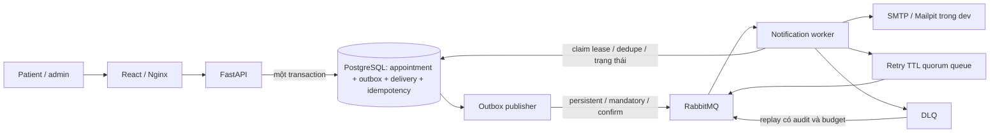

# Kiến trúc Mốc 1 [THIẾT KẾ]

PDF trang 1 yêu cầu frontend/backend/DB riêng; trang 5 thêm RabbitMQ, service thông báo, giám sát queue và KEDA. React, FastAPI, PostgreSQL, outbox, SMTP/Mailpit là quyết định triển khai theo brief. Luồng Mốc1 đã chạy thành công bằng Compose dev và có integration/browser/fault evidence; các lớp K8s/KEDA/monitoring/logging tập trung chưa triển khai. Xem ma trận và evidence index.

Ba entrypoint Python dùng chung package `services/clinic` và image để tránh copy model/contract, nhưng chạy thành ba tiến trình/container độc lập. `api.py` không kết nối RabbitMQ khi đặt lịch hoặc readiness; DB hoạt động thì có thể nhận lịch và giữ outbox trong lúc broker lỗi. Publisher và worker có HTTP riêng trên cổng 8001/8002 cho health, readiness và metrics. `migrate` là tác vụ chạy một lần, không phải backend phục vụ request; seed là lệnh riêng, không reset DB khi deploy.

Bổ sung theo yêu cầu giao diện: lịch có tùy chọn nhắc email, tác vụ bền vững ở `appointment_reminders`. Timer trong publisher khóa các lịch đến hạn, ghi event `appointment.reminder.v1` vào cùng outbox rồi dùng luồng RabbitMQ/worker hiện có. Nhắc trước60phút là lựa chọn thiết kế, không phải thời gian PDF quy định. Hủy/tắt nhắc và kiểm tra trạng thái ở worker chặn tác vụ chưa gửi; SMTP có cửa sổ không thể thu hồi/transaction chung. Xem [thiết kế và evidence Soft Minimal](soft-minimal.md).

Trong một transaction, API ghi idempotency theo user/operation/key, khóa slot, thêm appointment, outbox và delivery; lưu snapshot response. Unique index chỉ cho một BOOKED/COMPLETED mỗi slot là lớp bảo vệ cuối. Ràng buộc idempotency của PostgreSQL tuần tự hóa hai request trùng key; toàn bộ thay đổi rollback khi trả lỗi. Endpoint hủy khóa appointment, chỉ tạo một cancellation event, giữ lịch sử và giải phóng slot. Hoàn tất chỉ sau ends_at và vẫn giữ slot. Khung giờ có lịch bất kỳ không được xóa qua API.

Publisher claim outbox bằng `FOR UPDATE SKIP LOCKED`, lưu lease/token rồi commit trước I/O; chỉ đánh dấu published sau confirm và không bị return do mandatory. Chết sau confirm nhưng trước DB commit có thể phát lại cùng event_id. Worker khóa delivery; chỉ SENT/SKIPPED mới là đã gửi/bỏ qua thành công. FAILED_DLQ dừng xử lý tự động, cần replay có kiểm soát. Lease hết hạn cho phép phục hồi. Schema chỉ chứa ID và thời điểm/version, worker lấy địa chỉ nhận trong DB, không đưa email vào message/metric/log.

Một chu kỳ gồm lần gửi đầu và tối đa 3 retry (mặc định 10/30/60 giây); retry queue quorum có TTL và dead lettering at-least-once, consumer prefetch 1, manual ack. Chỉ ack khi gửi và ghi kết quả xong hoặc chuyển retry/DLQ được confirm và cập nhật DB. Main queue có dead-letter cho poison message; broker một node trong dev không phải HA. DLQ replay tối đa một chu kỳ thêm, giữ event_id, lưu replay_count và JSON audit; xem runbook. Test ranh giới dùng channel/sender giả được ghi rõ là unit test.

Trước khi gửi, worker đối chiếu trạng thái/version hiện tại; xác nhận cũ đã bị hủy được SKIPPED. Có kiểm tra lại ngay trước SMTP. Vẫn có cửa sổ giữa kiểm tra và lệnh gửi khi người dùng hủy đồng thời; email chứa ID và trạng thái, API là nguồn hiện tại. SMTP không có transaction chung với DB: provider nhận email rồi worker chết trước ghi SENT có thể gửi trùng. Message-ID ổn định hỗ trợ truy vết, không bảo đảm provider dedupe. Không hứa exactly-once.

Trust boundary dev: trình duyệt → Nginx/API; API xác thực JWT có exp/issuer/audience; admin kiểm tra server; token ở bộ nhớ trình duyệt. DB/broker/metrics/management chỉ bind loopback trên máy dev. Dev credentials random trong `.env` bị Git/Docker context loại trừ. Mailpit không chuyển email đến người thật. Production sẽ dùng TLS/cert-manager, secrets và RBAC theo namespace; các thành phần đó chưa triển khai.

Prometheus sẽ thu metrics nghiệp vụ API/publisher/worker và RabbitMQ exporter; Grafana/Alertmanager/EFK là Mốc 4. KEDA dự kiến đọc QueueLength qua management HTTP nội bộ và điều khiển worker; API HPA CPU là bộ riêng. Chưa có dashboard/cluster/scale evidence. Thông báo lịch hẹn và cảnh báo vận hành là hai luồng riêng.
