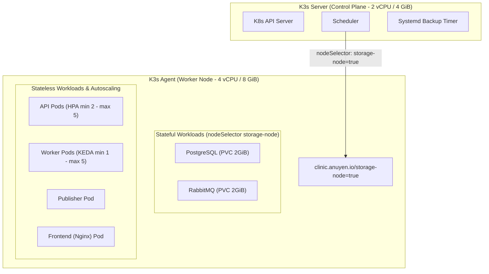

# Hướng dẫn và Bàn giao Kỹ thuật K3s Agent (Worker & Storage Node)

**Người phụ trách:** TV5 – Nguyễn Việt Anh (VietAnh - `vietanh2481`)  
**Người review:** TV2 – Vương (Vuong - `vxxngw`)  
**Tài liệu tham chiếu:** [infra/lab-budget.json](../../infra/lab-budget.json), [docs/guides/resource-budget.md](resource-budget.md), [deploy/k8s/](../../deploy/k8s/), [docs/guides/k8s-handoff.md](k8s-handoff.md)

---

## 1. Tổng quan vai trò K3s Agent (TV5)

Trong kiến trúc cụm Kubernetes (K3s) 3 máy ảo của đồ án (Đề tài số 8 – An Uyên Hospital), máy ảo **K3s Agent** đóng vai trò là **Worker Node duy nhất**, chịu toàn bộ tải tính toán và lưu trữ dữ liệu của hệ thống:

* **Tên Node:** `anuyen-agent`
* **Cấu hình phần cứng (theo ngân sách thiết kế):**
  * **CPU:** 4 vCPU
  * **RAM:** 8 GiB (8192 MiB)
  * **Ổ cứng ảo:** 48 GiB
  * **Hệ điều hành:** Ubuntu 24.04 LTS (x86_64)
* **Nhãn nhận diện đặc biệt:** `clinic.anuyen.io/storage-node=true`

---

## 2. Phân bổ Workloads trên K3s Agent

Do K3s Server chỉ đảm nhiệm Control Plane và sao lưu (backup), toàn bộ các Pod ứng dụng và cơ sở dữ liệu được định tuyến để chạy trên `anuyen-agent`:



1. **Stateful Workloads (Lưu trữ bền vững):**
   * `clinic-postgres-0`: Cơ sở dữ liệu chính, gắn PersistentVolumeClaim 2GiB. Khai báo `nodeSelector: clinic.anuyen.io/storage-node: "true"`.
   * `clinic-rabbitmq-0`: Message broker xử lý hàng đợi sự kiện, gắn PVC 2GiB. Khai báo `nodeSelector: clinic.anuyen.io/storage-node: "true"`.
2. **Stateless Workloads (Ứng dụng & Co giãn tự động):**
   * `clinic-api`: Backend FastAPI, co giãn tự động theo CPU (ngưỡng 60%) từ 2 đến 5 pod qua Horizontal Pod Autoscaler (HPA).
   * `clinic-worker`: Tiến trình tiêu thụ hàng đợi email, co giãn từ 1 đến 5 pod theo độ sâu hàng đợi RabbitMQ qua KEDA `ScaledObject`.
   * `clinic-publisher`: Quét bảng outbox và chuyển giao sự kiện vào RabbitMQ.
   * `clinic-frontend`: Nginx phục vụ giao diện người dùng React/TypeScript.

---

## 3. Quy trình Dựng và Gia nhập Cụm K3s Agent

### 3.1. Khởi tạo máy ảo trên phần mềm ảo hóa (VMware / VirtualBox)
1. Tạo máy ảo mới chạy **Ubuntu 24.04 LTS Server**.
2. Cấu hình phần cứng: 4 vCPU, 8192 MB RAM, 48 GB disk (Split virtual disk).
3. Thiết lập mạng: Chế độ **Bridged Adapter** (hoặc cùng dải mạng nội bộ với K3s Server) để hai máy có thể kết nối trực tiếp.
4. Tài khoản quản trị mặc định: `clinicops`.

### 3.2. Lệnh cài đặt K3s Agent và Gán nhãn Storage Node
Trên máy ảo `anuyen-agent`, thực thi câu lệnh gia nhập cụm:

```bash
curl -sfL https://get.k3s.io | K3S_URL=https://<IP_K3S_SERVER>:6443 \
  K3S_TOKEN="<K3S_SERVER_TOKEN>" \
  K3S_NODE_NAME="anuyen-agent" \
  INSTALL_K3S_EXEC="agent --node-label clinic.anuyen.io/storage-node=true" sh -
```

*Trong đó:*
* `<IP_K3S_SERVER>`: Địa chỉ IP của máy K3s Server trong cùng mạng.
* `<K3S_SERVER_TOKEN>`: Chuỗi token lấy từ K3s Server (`sudo cat /var/lib/rancher/k3s/server/node-token`).

---

## 4. Các Lệnh Kiểm tra và Xác minh (Verification)

### 4.1. Kiểm tra trạng thái Node trên K3s Server
```bash
# 1. Kiểm tra node anuyen-agent đã ở trạng thái Ready
kubectl get nodes -o wide

# 2. Xác minh nhãn storage-node đã được gán đúng
kubectl get nodes anuyen-agent --show-labels | grep "clinic.anuyen.io/storage-node=true"
```

### 4.2. Triển khai Workload và Kiểm tra Pod chạy trên Agent
```bash
# Triển khai toàn bộ workload môi trường staging
kubectl apply -k deploy/k8s/overlays/staging

# Kiểm tra danh sách Pod và đảm bảo NODE hiển thị là anuyen-agent
kubectl get pods -n clinic-staging -o wide
```
