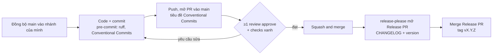

# Quy trình nhóm [Bài 1 – Giới thiệu DevOps]

Cập nhật 18/11/2026. Repo: <https://github.com/vxxngw/DevOps> (tài khoản cá nhân `vxxngw`, chuyển từ Organization cũ; URL cũ tự redirect). Nhóm có **5 người**. Bảng phân công chi tiết vẫn ở [Sheet 50 task](https://docs.google.com/spreadsheets/d/1py3DJf2rO_x2zK0-LcE8tERMtrn2S5lINx7nbnM8-48/edit) và [onboarding](team-onboarding.md); VietAnh chưa có task trong Sheet.

## 1. Phân vai

| Vai | Thành viên | GitHub | Nhánh làm việc | Phụ trách chính | PR được review bởi |
|---|---|---|---|---|---|
| TV1 | Hoang | `HoaAng911` (chưa nhận lời mời) | `Hoang` | API/UI/event contract, monitoring/logging/alert (Bài 10) | Long |
| TV2 | Vuong – chủ repo, điều phối | `vxxngw` | `codex/<task>` | Git/release, Docker/Compose/Jenkins, registry, CI security (Bài 2, 4–6, 11) | Hoang |
| TV3 | Long | `baolong205` | `Long` | Linux/Bash, Terraform/Ansible, backup, chi phí (Bài 3, 7–8, 12) | Thien |
| TV4 | Thien | `Thientao0609` | `Thien` | Kubernetes, HPA/KEDA, TLS/RBAC, rollout/rollback (Bài 9) | VietAnh |
| TV5 | VietAnh | chưa có – cần mời | `VietAnh` | *Đề xuất, chờ nhóm chốt:* QA/kiểm thử E2E, đo DORA (Bài 1 nâng cao), báo cáo và video | Vuong |

Vòng review: **Vuong → Hoang → Long → Thien → VietAnh → Vuong** (người đứng sau review PR của người đứng trước). Không tự approve PR của mình, không dùng chung tài khoản Git. Thay đổi contract, migration, Jenkinsfile hoặc tài nguyên dùng chung cần báo cả nhóm trước khi merge.

## 2. Kênh trao đổi

| Kênh | Dùng cho |
|---|---|
| Nhóm **Zalo** | Trao đổi hằng ngày, báo blocker, nhắc review |
| GitHub Issues | Mỗi task một issue có người nhận; quyết định kỹ thuật ghi vào issue/PR hoặc [decisions.md](decisions.md) |
| GitHub Pull Request | Review code, ghi lệnh đã chạy và bằng chứng |
| Google Sheet | Bảng phân công và trạng thái task |

Quyết định chốt trên Zalo phải được ghi lại vào issue/PR để còn dấu vết.

## 3. Luồng làm việc với Git

1. Trước khi làm: `git fetch origin && git merge origin/main` trên nhánh của mình. Việc lớn tách nhánh con `Ten/<task>` từ main.
2. Cài hook một lần: `pip install pre-commit && pre-commit install` (xem [CONTRIBUTING](../../CONTRIBUTING.md)).
3. Commit theo [Conventional Commits](https://www.conventionalcommits.org/): `feat(api): ...`, `fix(worker): ...`, `docs: ...`, `ci: ...`.
4. Mở PR vào `main`, điền template, gán reviewer theo vòng ở mục 1. Tiêu đề PR được workflow `pr-title` kiểm.
5. `main` được bảo vệ: không push thẳng, không force-push, PR cần ≥1 approve và hết conversation mở.
6. Merge bằng **Squash and merge** để mỗi PR là một commit Conventional trên main.
7. release-please tự mở Release PR; merge PR đó sẽ gắn tag semver và cập nhật `CHANGELOG.md`.

## 4. Definition of Done

Một task chỉ được tính là xong khi:

- [ ] Có issue/owner, PR nhỏ đúng nhánh, ≥1 review thật theo vòng review.
- [ ] Checks liên quan đã chạy (pre-commit, test, Jenkins nếu đụng code/CI) và ghi lệnh/kết quả trong PR.
- [ ] Không có secret, `.env`, state hay dữ liệu thật trong diff/evidence; không bỏ qua security gate.
- [ ] Config, runbook, tài liệu liên quan được cập nhật; dòng tương ứng trong [ma trận](../compliance-matrix.md) đúng trạng thái (chưa chạy ghi `IMPLEMENTED_NOT_RUN`, thiếu điều kiện ghi `BLOCKED`).
- [ ] Migration tương thích bản app trước để rollback được.
- [ ] Các thành viên còn lại giải thích được phần vừa merge khi vấn đáp.

## 5. Sơ đồ kiến trúc tổng thể

Xem [architecture.md – Sơ đồ tổng thể](architecture.md#sơ-đồ-tổng-thể): luồng Dev → GitHub → Jenkins → registry → Kubernetes staging/production và lớp giám sát.

## 6. Việc còn lại cho Bài 1–2

**Bắt buộc**

- [ ] **VietAnh:** gửi GitHub username; **Vuong** mời làm collaborator. **Hoang:** chấp nhận lời mời đang chờ.
- [ ] **Cả 5 người:** clone repo, đặt `git config user.name/user.email` khớp tài khoản GitHub (để commit được tính đúng người), cài pre-commit.
- [ ] **Cả 5 người:** mỗi người có ít nhất 1 PR merge vào main, do người kế tiếp trong vòng review approve (PR đầu tiên theo [onboarding](team-onboarding.md)).
- [ ] **Nhóm:** chốt vai TV5 cho VietAnh và thêm task vào Sheet.
- [ ] **Vuong:** merge Release PR đầu tiên để có tag `v0.1.0`.
- [ ] **Nhóm:** xác nhận đăng ký đề tài với lớp.
- [ ] **Vuong:** lưu bằng chứng: ảnh ruleset của main, một PR có review, `git log --oneline`, `git tag`, `git shortlog -sn main`.

**Nâng cao**

- [x] Pre-commit hook lint/format (ruff) và kiểm commit message.
- [x] Tự sinh CHANGELOG từ commit (release-please).
- [ ] **Đo DORA trong 2 tuần cuối** (đề xuất VietAnh): tần suất deploy = số lần deploy production; lead time = từ commit đầu của PR đến lúc lên production; thời gian khôi phục = từ alert FIRING đến RESOLVED/rollback xong; tỉ lệ thay đổi gây lỗi = số deploy phải rollback/hotfix ÷ tổng deploy. Nguồn: lịch sử Jenkins, tag/release GitHub, Alertmanager.
- [ ] **Tách repo ứng dụng và repo cấu hình triển khai** (đề xuất Thien + Vuong): chuyển `deploy/k8s` sang repo riêng; Jenkins cập nhật image digest ở repo đó thay vì repo code.
